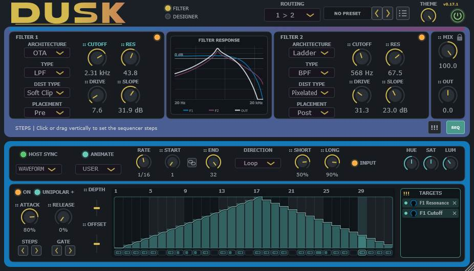

# Dusk

<div align="center">

[](https://github.com/sl2365/Dusk/releases/latest/download/Dusk.rar)
[](https://github.com/sl2365/Dusk/releases)

[](https://github.com/sl2365/Dusk/releases/latest)
[](https://github.com/sl2365/Dusk/releases)

</div>

Dusk is a dual creative-filter VST3 by Dead Channel Audio. Each filter combines standard response controls with a selectable DSP architecture, editable architecture-specific Designer settings, its own distortion stage and sequencer modulation.



## Requirements

- Windows x64
- A 64-bit VST3 host
- A writable VST3 folder if Dusk's portable settings, presets, sequences and Models are to remain beside the plugin

## Installation

1. Extract `Dusk.vst3` from the release archive.
2. Copy it into a folder scanned by the host for VST3 plugins.
3. Rescan plugins in the host and load Dusk as an audio effect.

Dusk creates a portable `Dusk` data folder beside the installed plugin. If the chosen VST3 folder is protected by Windows, give the current account write access or use another scanned folder that is writable.

## Quick start

1. Select `Filter 1`, `Filter 2`, `1 > 2` or `1 + 2` from Routing.
2. Use each amber filter LED to switch that filter on or off. Lit means on.
3. Choose an Architecture and a standard filter Type for each active filter.
4. Set Cutoff, Resonance and the continuous 6–48 dB/octave Slope.
5. Add Drive, choose a distortion Type, then choose its Pre, Internal or Post Placement.
6. Open DESIGNER to change the controls belonging to the selected Architecture or recall a Model.
7. Use MIX and OUT to set the final wet balance and level.

Hover any control or its label to see its matching description in the fixed help strip.

## Signal routing

| Routing | Signal path |
|---|---|
| Filter 1 | Filter 1 only |
| Filter 2 | Filter 2 only |
| 1 > 2 | Filter 1 feeds Filter 2 in series |
| 1 + 2 | Both filters process the input in parallel and are gain-compensated before mixing |

The response display follows the selected architectures, Types, Cutoff, Resonance, Slope and applicable Designer controls. It shows the exact small-signal filter response; nonlinear saturation and selectable distortion cannot be represented by one fixed level-independent curve.

## FILTER view

Each side controls one independent filter engine.

| Control | Function |
|---|---|
| Architecture | Selects the genuine DSP structure: Clean SVF, Ladder or OTA |
| Type | Selects LPF, BPF, HPF, NOTCH or PEAK |
| Cutoff | Sets the principal frequency from 20 Hz to 20 kHz |
| Resonance | Emphasises the response around Cutoff |
| Slope | Continuously changes the response from 6 to 48 dB/octave |
| Drive | Sets the amount sent to the selected distortion model |
| Dist Type | Selects one of the 17 distortion models |
| Placement | Places that distortion before, inside or after the filter |
| Amber LED | Powers the individual filter on or off; lit is on |

PEAK is the selected architecture's resonant peak response. It is not a parametric-EQ bell with a separate gain control.

## Architectures

Architecture chooses how the filter is actually calculated. Changing Architecture also changes the controls shown on the DESIGNER view.

### Clean SVF

A topology-preserving state-variable core with continuously blended one-pole and cascaded-stage responses. It provides the widest general-purpose Designer set and an additional bounded feedback return.

### Ladder

A nonlinear cascaded-pole filter with one to eight continuously blended poles. The 24 dB position uses four poles. Resonance is handled by a delay-free feedback solution rather than by relabelling the Clean SVF.

### OTA

A nonlinear cascade of one to eight transconductance-style cells with a damped bounded feedback return. The 24 dB position uses four cells.

There is not currently a Comb filter architecture. `Comb` in the Dist Type list is a distortion model with a short resonator and should not be confused with a dedicated Comb filter.

## DESIGNER view

Designer controls edit the character of the selected Architecture. They do not replace the standard Type, Cutoff, Resonance, Slope or Drive controls on FILTER.

### Clean SVF Designer

| Control | Function |
|---|---|
| Res Shape | Changes how quickly the Resonance control builds from restrained to aggressive |
| Res Limit | Limits the maximum effective resonance |
| Bass Loss | Adds resonance-linked low-frequency thinning |
| Core Sat | Saturates the completed filter core; 0% is transparent |
| Sat Asym | Biases Core Sat toward one polarity for even-harmonic character; it requires Core Sat |
| Pole Spread | Separates applicable cascaded stages; it is inactive at 12 dB/octave and below |
| Feedback | Returns the completed filter output through a bounded one-sample loop |
| FB Limit | Sets how tightly the Designer Feedback return is constrained; it requires Feedback |

### Ladder Designer

| Control | Function |
|---|---|
| Stage Sat | Changes the nonlinearity inside every active Ladder stage |
| FB Sat | Saturates the Ladder resonance return inside its delay-free solve |
| Res Comp | Restores level as Resonance rises |

### OTA Designer

| Control | Function |
|---|---|
| Cell Drive | Changes the nonlinearity inside every active OTA cell |
| FB Damp | Low-pass damps and restrains the OTA resonance return |
| Res Comp | Restores level as Resonance rises |

## Filter Models

A Model is an editable configuration of one Architecture and its supported Designer controls. It is not another filter Type and it does not change Type, Cutoff, Resonance, Slope, Drive, routing, sequencer settings or the other filter.

Factory Models provide starting points for Clean SVF, Ladder and OTA. After recalling one, move any included Designer control to customise it; the Model display then changes to `CUSTOM` without undoing the recalled values.

Use the `...` button beside either Model selector to:

- save that filter's current Architecture and Designer settings as a User Model;
- refresh the shared User Model list; or
- open the portable Models folder.

A User Model saved from Filter 1 can be recalled by Filter 2 and vice versa. User Models use `.duskmodel`; full-plugin presets use `.duskpreset`.

## Distortion

Each filter has an independent distortion model, Drive amount and Placement. Available models are:

`Amp`, `Asym`, `Bumpy`, `Comb`, `Crackle`, `Fresh`, `Fuzz`, `Hard Clip`, `Lightning`, `Pixelated`, `Razor`, `Rectify`, `Samurai`, `Saturation`, `Soft Clip`, `Stressed` and `Tube`.

The list is naturally sorted; each visible name remains mapped to its own DSP algorithm.

| Placement | Function |
|---|---|
| Pre | Distorts the signal before it enters the filter core |
| Internal | Distorts an architecture-specific feedback return inside the filter |
| Post | Distorts the completed filter output |

Internal behaves according to the selected Architecture:

- Clean SVF shapes the bounded Designer Feedback return, so it requires the Clean SVF `Feedback` control to be above 0%.
- Ladder shapes the stored resonance feedback component before the protected delay-free solve, so it requires `Resonance`.
- OTA shapes the damped bounded resonance return before it is subtracted from the input, so it requires `Resonance`.

The external Pre/Post path and each Architecture's Internal path use separate state memory. Stateful models such as Comb therefore cannot carry external-placement history into an Architecture's feedback path, or internal history from one Architecture into another.

## Sequencer

Press `SEQ` to show or hide the 32-step parameter sequencer.

### Creating a pattern

- Click or drag vertically across the step grid to set values.
- Use Waveform to replace the grid with a generated shape.
- Set Start and End to restrict the active range; enable the link button to move that range without changing its length.
- Use Loop, Bounce, Reverse, Played or Random direction.
- Enable Host Sync for tempo-locked rates, or disable it for the free/played behaviour.
- Attack and Release smooth rising and falling changes.
- Depth expands or contracts the complete pattern; Offset moves it vertically.
- Cycle the polarity LED through Unipolar +, Bipolar and Unipolar - to choose how modulation moves its targets.

### Assigning targets

Drag a parameter label marked `::` onto one of the 16 target slots. The target's small knob sets its individual modulation Depth, and its LED enables or disables that assignment. `ANIMATE` displays the resulting control movement without replacing stored parameter values.

### Gate steps

Each step can be Off, Short, Long or Rest. SHORT and LONG set the open duration. Gate can act on Input, Effect, Output or be switched Off independently of parameter modulation.

User sequences are stored as `.duskseq` files in the portable Sequences folder.

## Presets and global controls

- Open the preset browser with the list button.
- Use Save to overwrite the current preset or Save As to create a new `.duskpreset`.
- Use the arrow buttons, keyboard Left/Right keys or mouse wheel over the preset name to step through presets.
- Right-click the current preset name for the quick menu.
- MIX LOCK keeps the current MIX value when another preset is loaded.
- The global Power LED bypasses or enables Dusk processing.
- THEME changes the interface colour treatment.
- Drag the resize handle to scale the interface from 75% to 200%.
- The randomise button changes supported filter and Designer controls within bounded ranges while leaving Architecture, routing, filter power, Placement, MIX, global Power and sequencer state unchanged.

## Portable files

Dusk keeps its user data beside `Dusk.vst3`:

```text
Dusk/
├── Settings/
│   └── Settings.ini
├── Presets/
│   └── *.duskpreset
├── Sequences/
│   └── *.duskseq
└── Models/
    └── *.duskmodel
```

Back up this folder with the plugin to preserve all user content and interface settings.

## Building from source

Place the project at `_Projects\Dusk` beside `_Projects\_Tools`, then double-click `- Build.bat`.

The supplied build script expects:

- CMake at `_Projects\_Tools\cmake\_4.4.2\bin\cmake.exe`;
- JUCE 9.0.4 at `_Projects\_Tools\JUCE\_9.0.4`; and
- Visual Studio Community 2026 with the x64 C++ toolchain.

The script closes `PolyHostInterface.exe` before compiling, so save any work open in PHI first. It configures and builds the Release VST3, validates the output as Windows x64 and writes `dist\Dusk.vst3`. It does not install the plugin automatically.

If the build fails, read or supply the generated `Results.log`; it contains the complete configuration and compiler output.

## Project identity

| Field | Value |
|---|---|
| Manufacturer | `sl23` |
| Manufacturer code | `sl23` |
| Plugin code | `dsk1` |
| Bundle ID | `com.sl23.dusk` |
| VST3 category | `Fx Filter` |

Release history and implementation changes are documented in [Changelog.md](Changelog.md).
