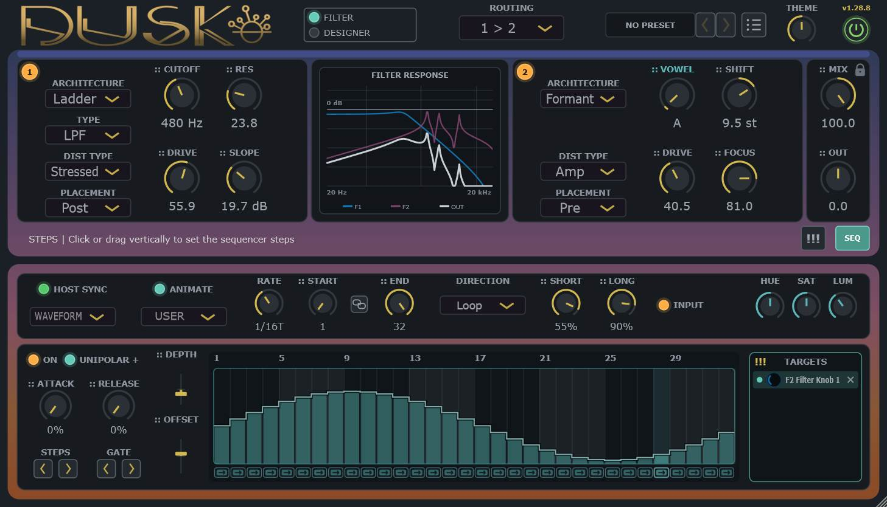
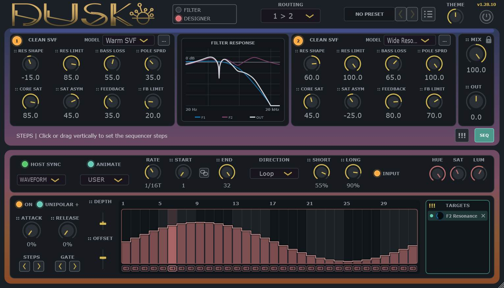

# Dusk

<div align="center">

[](https://github.com/sl2365/Dusk/releases/latest/download/Dusk.rar)
[](https://github.com/sl2365/Dusk/releases)
[](https://github.com/sl2365/Dusk/releases/latest)
[](https://github.com/sl2365/Dusk/releases)

</div>

Dusk is a dual creative-filter VST3 by Dead Channel Audio. Each filter combines standard response controls with a selectable DSP architecture, editable architecture-specific Designer settings, its own distortion stage and sequencer modulation.





## Requirements

- Windows x64
- A 64-bit VST3 host
- A writable VST3 folder if Dusk's portable settings, presets, sequences and Models are to remain beside the plugin

## Installation

1. Extract `Dusk.vst3` from the release archive.
2. Copy it into a folder scanned by the host for VST3 plugins.
3. Rescan plugins in the host and load Dusk as an audio effect.

Dusk creates a portable `Dusk_Data` folder beside the installed plugin. Existing `Dusk` folders are renamed automatically. If the chosen VST3 folder is protected by Windows, give the current account write access or use another scanned folder that is writable.

## Quick start

1. Select `Filter 1`, `Filter 2`, `1 > 2` or `1 + 2` from Routing.
2. Use each amber filter LED to switch that filter on or off. Lit means on.
3. Choose an Architecture for each active filter. Clean SVF, Ladder, Diode Ladder, Steiner-Parker, Vactrol/LPG, Korg-35/MS-20, OTA and Sallen-Key use the standard Type control; Comb, Formant, Phaser, Modal Resonator and Spectral Bank provide their own main controls.
4. For standard architectures, set Cutoff and Resonance. LPF, BPF, HPF, Notch and Peak use the continuous 6–48 dB/octave Slope; LO SHELF, HI SHELF, Bell and Tilt replace Slope with a -18 to +18 dB Gain control. Comb uses Frequency, Feedback and Damping; Formant uses Vowel, Shift and Focus; Phaser uses Frequency, Feedback and Depth; Modal Resonator uses Frequency, Decay and Body; Spectral Bank uses Frequency, Span and Depth.
5. Add Drive, choose a distortion Type, then choose its Pre, Internal or Post Placement.
6. Click anywhere inside the outlined FILTER/DESIGNER selector to swap views, then use DESIGNER to change the controls belonging to the selected Architecture or recall a Model.
7. Use MIX and OUT to set the final wet balance and level.

Hover any control or its label to see its matching description in the fixed help strip.

## Signal routing

| Routing | Signal path |
|---|---|
| Filter 1 | Filter 1 only |
| Filter 2 | Filter 2 only |
| 1 > 2 | Filter 1 feeds Filter 2 in series |
| 1 + 2 | Both filters process the input in parallel and are gain-compensated before mixing |

The response display follows the selected architectures and their applicable FILTER and DESIGNER controls. It shows the exact small-signal filter response; nonlinear saturation, high-level limiting and selectable distortion cannot be represented by one fixed level-independent curve. Comb Stereo Spread and Phaser Stereo are excluded because the compact display represents the centre-tuned mono response. Modal Resonator shows every active mode, its decay envelope and the Body blend. Spectral Bank shows every active analysis band with its Width, Pattern, Shift, Contrast and Tilt weighting. Sallen-Key includes Q Curve, Cell Gain, Stage Coupling, Component Variation and HF Damping; Op Sat is nonlinear and therefore excluded. Diode Ladder includes Stage Tilt, Resonance Loss, Resonance Compensation and its 5 Hz DC protection. Steiner-Parker includes Pole Spread, Resonance Curve, Resonance Compensation and DC protection. Their diode drive, feedback clipping and Bias controls are nonlinear and are excluded from the level-independent curve. Vactrol/LPG includes its static LPG Level and Bleed attenuation; the time-dependent Rise, Fall and Memory controls and nonlinear Warmth are not representable by a static curve. Korg-35/MS-20 includes Feedback Tone, Bass Loss and Resonance Compensation; Chip Drive, Feedback Clip and Bias are nonlinear and are excluded.

## FILTER view

Each side controls one independent filter engine.

| Control | Function |
|---|---|
| Architecture | Selects the genuine DSP structure: Clean SVF, Ladder, Diode Ladder, Steiner-Parker, Vactrol/LPG, Korg-35/MS-20, OTA, Comb, Formant, Phaser, Modal Resonator, Sallen-Key or Spectral Bank |
| Type | For standard architectures, selects LPF, BPF, HPF, NOTCH, PEAK, LO SHELF, HI SHELF, BELL or TILT |
| Cutoff | For standard architectures, sets the principal or pivot frequency from 20 Hz to 20 kHz |
| Resonance | For standard architectures, emphasises the response around Cutoff and sets the Bell width/character |
| Slope | For LPF, BPF, HPF, NOTCH and PEAK, continuously changes the response from 6 to 48 dB/octave |
| Gain | For LO SHELF, HI SHELF, BELL and TILT, replaces Slope and sets -18 to +18 dB of boost/cut |
| Comb Mode | For Comb, selects Feedback, Feedforward or All-pass |
| Frequency | For Comb, sets the fundamental delay frequency from 20 Hz to 8 kHz |
| Feedback | For Comb, sets the amount and strength of the delayed branch |
| Damping | For Comb, darkens the delayed branch and shortens bright ringing |
| Vowel | For Formant, morphs continuously through A, E, I, O and U |
| Shift | For Formant, moves all three vocal bands together by plus or minus 24 semitones |
| Focus | For Formant, changes the three vocal bands from broad and gentle to sharp and prominent |
| Frequency | For Phaser, moves the complete phase-cancellation pattern from 20 Hz to 20 kHz |
| Feedback | For Phaser, sets positive or negative bounded feedback around the all-pass cascade |
| Depth | For Phaser, changes the internal dry/all-pass blend from transparent to deep notches |
| Frequency | For Modal Resonator, sets the fundamental mode from 20 Hz to 4 kHz |
| Decay | For Modal Resonator, sets the fundamental ringing time from 20 ms to 5 seconds |
| Body | For Modal Resonator, blends from the direct signal to the resonant body |
| Frequency | For Spectral Bank, sets the logarithmic centre of the complete band pattern from 40 Hz to 8 kHz |
| Span | For Spectral Bank, spreads the analysis bands across 0.5 to 6 octaves |
| Depth | For Spectral Bank, blends continuously from the direct signal to the weighted band bank |
| Drive | Sets the amount sent to the selected distortion model |
| Dist Type | Selects one of the 17 distortion models |
| Placement | Places that distortion before, inside or after the filter |
| Amber LED | Powers the individual filter on or off; lit is on |

PEAK remains the selected architecture's resonant peak response. BELL is the separate parametric response with its own Gain control. The four EQ Types use a fixed 12 dB/two-pole architecture core so hidden Slope settings cannot silently alter their shape.

## Architectures

Architecture chooses how the filter is actually calculated. Changing Architecture also changes the controls shown on the DESIGNER view.

### Clean SVF

A topology-preserving state-variable core with continuously blended one-pole and cascaded-stage responses. It provides the widest general-purpose Designer set and an additional bounded feedback return.

### Ladder

A nonlinear cascaded-pole filter with one to eight continuously blended poles. The 24 dB position uses four poles. Resonance is handled by a delay-free feedback solution rather than by relabelling the Clean SVF.

### Diode Ladder

A separate diode-coupled cascade with one to eight continuously blended stages. It keeps the familiar Type, Cutoff, Resonance and Slope workflow, but its stage nonlinearity, asymmetric diode thresholds and clipped feedback solve produce a sharper and more aggressive character than the existing Ladder.

Diode Sat controls nonlinear compression inside every stage. Feedback Clip shapes the resonance return separately, while Bias offsets the positive and negative diode thresholds without leaving a permanent DC offset. Stage Tilt spreads the eight internal stage frequencies around Cutoff. Resonance Loss progressively reduces available feedback as Resonance rises, and Resonance Compensation restores level independently. The engine uses a delay-free iterative feedback solution, bounded output and a gentle 5 Hz DC blocker; all eight stage states remain live during Architecture crossfades.

### Steiner-Parker

A diode multimode state-variable core with continuously blended 6–48 dB/octave operation. Unlike the cascaded Ladder structures, each two-pole cell produces low-pass, band-pass and high-pass outputs simultaneously before the selected Type is formed, giving it a sharper and more direct multimode character.

Diode Drive colours each cell, Feedback Clip constrains and hardens the local resonance return, and Bias shifts the positive and negative diode thresholds in opposite directions. Pole Spread separates the cell frequencies, Resonance Curve changes where high-Q behaviour arrives across the Resonance knob, and Resonance Compensation restores level as resonance rises. Nonlinear controls retain independent state and a 5 Hz DC blocker protects strongly biased settings.

### Vactrol/LPG

A dynamic optocoupler-inspired filter and low-pass gate. It keeps the standard Type, Cutoff, Resonance and continuous 6–48 dB/octave Slope or EQ Gain workflow, but the effective Cutoff follows control movement with independently adjustable opening and closing times. This produces rounded plucks, slow blooms and organic asymmetric movement that a static filter cannot provide.

LPG Level couples low Cutoff settings to amplitude reduction, while Bleed sets how much signal remains when the gate is closed. Memory extends the closing response according to recent signal energy, and Warmth adds bounded optical-circuit colour. Set LPG Level to 0% for a dynamic filter without low-pass-gate attenuation.

### Korg-35/MS-20

A nonlinear two-pole feedback architecture inspired by the aggressive Korg-35/MS-20 family. Each cell uses two cascaded topology-preserving one-pole stages inside an iterated resonance solve rather than reusing the SVF or Ladder engines. The first cell carries the main resonance character; later cells remain active for continuous 12–48 dB/octave slopes, with a true one-pole path at 6 dB/octave.

Chip Drive colours the signal inside every cell, while Feedback Clip independently hardens the resonance return. Bias moves both nonlinear curves toward either polarity and a 5 Hz DC blocker protects strongly asymmetric settings. Feedback Tone progressively removes low frequency from the resonance path, Bass Loss controls resonance-linked low-end thinning and Resonance Compensation restores output level independently.

### OTA

A nonlinear cascade of one to eight transconductance-style cells with a damped bounded feedback return. The 24 dB position uses four cells.

### Comb

A fractional-delay filter with three independently running structures. Feedback recirculates the delayed branch for resonant ringing, Feedforward creates a non-recurring notch/peak pattern, and All-pass changes phase while retaining a nominally flat linear magnitude response. Changing Mode crossfades the live engines instead of interpolating incompatible coefficients or clearing their state.

Frequency movement uses perceptual smoothing so long, low-frequency delay times do not jump abruptly while the control is moved or automated. The 20 Hz–8 kHz range keeps meaningful repeated teeth available throughout the knob instead of spending its upper section above the useful audible Comb range. A magnitude-preserving fractional-delay stage retains much more of the delayed branch at high frequencies than linear interpolation.

Feedback and audible delayed-branch level use separate curves: the recirculating loop remains safely below unity while the output branch is strong enough to make low and moderate Feedback positions clearly audible. Damping uses a gentler shaped range, retaining substantially more brightness at ordinary settings while still becoming dark at its upper extreme. At very high Feedback and low Frequency, a gentle internal low-cut progressively restrains sub-bass accumulation while leaving the main pitched and metallic Comb character intact. This protection is included in the response display and requires no extra control.

The Comb Architecture and the `Comb` distortion model are separate. The Architecture is a complete filter engine with Frequency, Feedback, Damping and dedicated Designer controls; the distortion model is a short resonant colour available in the Dist Type list.

### Formant

A three-band vocal resonator built from independent topology-preserving band-pass filters. Vowel morphs logarithmically through A, E, I, O and U rather than switching between fixed snapshots, so the intermediate positions remain usable sounds. Shift moves the complete vocal spectrum without changing its internal proportions, while Focus changes the prominence and sharpness of all three bands. Designer Width changes their bandwidth separately without changing peak emphasis.

Formant has no standard LPF/BPF/HPF Type because its three simultaneous vocal bands are the architecture. Its complete linear response, including every Designer level, Width, Spread and Tilt setting, is shown in the permanent response display.

### Phaser

A cascade of twelve continuously running first-order all-pass stages. The Stages control blends between the outputs of 2, 4, 6, 8, 10 and 12 stages instead of clearing state or abruptly switching DSP. Frequency moves the complete stage pattern, positive or negative Feedback reshapes the notches, and Depth controls the internal cancellation blend. Stage Sat's cumulative gain remains in the audible output, while an automatic loop-gain guard removes only that excess gain from the feedback return when it would cross the stable margin. This prevents a sustained squeal without flattening Stages or Stage Sat.

Phaser has no fixed internal LFO. Move or automate Frequency directly, or assign it to Dusk's sequencer for rhythmic and continuously repeating sweeps. The permanent response display includes Frequency, Feedback, Depth, Stages, Spread, Skew and feedback Damping. Stage Saturation, Stereo and selectable distortion are intentionally excluded from the mono small-signal curve.

### Modal Resonator

An eight-mode parallel resonator bank that turns transients, drums and sustained material into tuned physical-body colour. Frequency sets the fundamental, Decay controls its ringing time, and Body blends the direct signal with the resonant bank. Each mode uses a stable two-pole resonator with bounded energy compensation, keeping long rings audible instead of making high-Decay settings disappear. A smooth high-level guard restrains pathological sustained resonance without changing ordinary small-signal behaviour.

Modes fades the resonances in continuously instead of switching them abruptly. Ratio morphs from a harmonic series toward irregular metallic ratios, while Inharm changes how strongly the upper ratios compress or stretch. Decay Tilt can lengthen or shorten the upper modes; Damping progressively shortens high-mode ringing without shortening the fundamental; Excite tilts the energy from dark lower modes to bright upper modes.

Modal Resonator has no standard LPF/BPF/HPF Type because its bank of pitched modes is the architecture. Internal distortion processes every mode separately with independent state. The permanent response display uses the same frequencies, radii, normalisation and Body blend as the audio path.

### Sallen-Key

A cascade of four continuously running active two-pole cells. It uses the standard Type, Cutoff, Resonance and continuous 6–48 dB/octave Slope controls, while the Designer changes the response of the active cells themselves. At 6 dB the output starts from a true one-pole path, blends into the first two-pole cell by 12 dB, then moves continuously through two, three and four cells at 24, 36 and 48 dB/octave.

Q Curve changes how the Resonance knob reaches the available cell Q. Cell Gain increases the active positive-feedback character and maximum Q. Stage Coupling determines how strongly later cells share that resonance, while Component Variation spreads the cells around Cutoff using a repeatable component-tolerance pattern. Op Sat adds bounded nonlinear colour after each cell without clearing its state. HF Damping progressively restrains and darkens the later cells.

### Spectral Bank

An eight-band parallel analysis bank built from topology-preserving band-pass filters. It is a zero-latency time-domain architecture rather than an FFT process, so it adds neither transform latency nor fixed processing blocks. Frequency positions the centre of the complete pattern, Span controls its octave range and Depth blends the weighted bank with the direct signal.

Bands fades filters in from the centre outward instead of switching them abruptly. Width controls their Q, Pattern changes the repeated spectral weighting, Shift rotates that weighting across the bank, Contrast moves from a flat bank toward pronounced peaks and troughs, and Tilt rebalances low against high bands. Unlike Formant's three vocal resonances, Spectral Bank produces a configurable multi-band pattern; unlike Modal Resonator, its filters analyse and reshape the current signal rather than generating long pitched ringing.

## DESIGNER view

Designer controls edit the character of the selected Architecture. Clean SVF, Ladder, Diode Ladder, Steiner-Parker, Vactrol/LPG, Korg-35/MS-20, OTA and Sallen-Key keep the standard Type, Cutoff and Resonance controls on FILTER, plus Slope or Gain according to Type. Comb provides Mode, Frequency, Feedback and Damping; Formant provides Vowel, Shift and Focus; Phaser provides Frequency, Feedback and Depth; Modal Resonator provides Frequency, Decay and Body; Spectral Bank provides Frequency, Span and Depth. Drive remains available for every Architecture.

### Clean SVF Designer

| Control | Function |
|---|---|
| Res Shape | Changes how quickly the Resonance control builds from restrained to aggressive |
| Res Limit | Limits the maximum effective resonance |
| Bass Loss | Adds resonance-linked low-frequency thinning |
| Core Sat | Saturates the completed filter core; 0% is transparent |
| Sat Asym | Biases Core Sat toward one polarity for even-harmonic character; it requires Core Sat |
| Pole Spread | Separates applicable cascaded stages; it is inactive at 12 dB/octave and below |
| Feedback | Returns the completed filter output through a bounded one-sample loop |
| FB Limit | Sets how tightly the Designer Feedback return is constrained; it requires Feedback |

### Ladder Designer

| Control | Function |
|---|---|
| Stage Sat | Changes the nonlinearity inside every active Ladder stage |
| FB Sat | Saturates the Ladder resonance return inside its delay-free solve |
| Res Comp | Restores level as Resonance rises |

### Diode Ladder Designer

| Control | Function |
|---|---|
| Diode Sat | Adds nonlinear diode compression inside every ladder stage |
| FB Clip | Clips and colours the resonance feedback path independently from stage saturation |
| Bias | Changes the positive and negative diode thresholds in opposite directions; 0% is symmetrical |
| Stg Tilt | Spreads the stage frequencies around Cutoff; opposite settings reverse the internal tilt |
| Res Loss | Reduces available feedback progressively as Resonance rises |
| Res Comp | Restores level as Resonance rises |

### Steiner-Parker Designer

| Control | Function |
|---|---|
| Diode Drv | Drives and colours every Steiner-Parker cell |
| FB Clip | Clips the local resonance returns for sharper nonlinear peaks |
| Bias | Changes the positive and negative diode thresholds in opposite directions |
| Pole Sprd | Spreads the cascaded cell frequencies around Cutoff |
| Res Curve | Reshapes how quickly the Resonance knob reaches high-Q behaviour |
| Res Comp | Restores level progressively as Resonance rises |

### Vactrol/LPG Designer

| Control | Function |
|---|---|
| Rise | Sets the virtual vactrol opening time from near-instant to a soft optical swell |
| Fall | Sets the closing time from tight plucks to long organic tails |
| Memory | Lengthens closing according to recent signal energy |
| LPG Level | Couples Cutoff to amplitude so the filter also behaves as a low-pass gate |
| Warmth | Adds smooth bounded optical-circuit saturation |
| Bleed | Sets the residual signal level when the low-pass gate is closed |

### Korg-35/MS-20 Designer

| Control | Function |
|---|---|
| Chip Drv | Drives every nonlinear two-pole cell from clean to strongly compressed |
| FB Clip | Clips and hardens the resonance feedback return independently from Chip Drive |
| Bias | Shifts the nonlinear drive and feedback curves toward either polarity |
| FB Tone | Removes progressively more low frequency from the feedback return for thinner, more cutting resonance |
| Bass Loss | Sets the amount of resonance-linked low-frequency thinning |
| Res Comp | Restores output level progressively as Resonance rises |

### OTA Designer

| Control | Function |
|---|---|
| Cell Drive | Changes the nonlinearity inside every active OTA cell |
| FB Damp | Low-pass damps and restrains the OTA resonance return |
| Res Comp | Restores level as Resonance rises |

### Comb Designer

| Control | Function |
|---|---|
| Fine Tune | Offsets the Comb frequency by plus or minus 100 cents |
| Polarity | Moves continuously between negative and positive delayed polarity; 0% removes the delayed branch |
| Stereo | Detunes the left and right delay frequencies in opposite directions by up to 100 cents |
| Dispersion | Adds all-pass phase dispersion inside the delayed branch |
| Loop Sat | Saturates and compresses the delayed branch at higher levels |
| FB Limit | Sets the high-level ceiling used to restrain ringing |

### Formant Designer

| Control | Function |
|---|---|
| F1 Level | Sets the lowest vocal resonance from silent to twice its natural level |
| F2 Level | Sets the middle resonance that carries much of the vowel identity |
| F3 Level | Sets the highest resonance controlling presence and articulation |
| Width | Scales all three vowel bandwidths from 50% to 200% |
| Spread | Compresses or expands the outer formants around the middle band by up to half an octave |
| Tilt | Rebalances the formants continuously from low and throaty to high and bright |

### Phaser Designer

| Control | Function |
|---|---|
| Stages | Continuously blends from 2 to 12 active all-pass stages; more stages create more notches |
| Spread | Expands the paired stage frequencies from a tight cluster to a broad six-octave pattern |
| Skew | Redistributes the stage frequencies around the centre without moving Frequency |
| FB Damp | Low-pass damps the Phaser feedback return |
| Stage Sat | Strongly saturates every all-pass stage, producing cumulative colour and level interaction as Stages increases; the protected feedback return prevents runaway resonance |
| Stereo | Moves the left and right stage patterns in opposite directions by up to three quarters of an octave |

### Modal Resonator Designer

| Control | Function |
|---|---|
| Modes | Continuously fades from one to eight active resonant modes |
| Ratio | Morphs the mode spacing from harmonic to irregular metallic ratios |
| Inharm | Compresses or stretches upper-mode ratios while retaining the fundamental |
| D Tilt | Tilts the upper modes toward shorter or longer decay times |
| Damp | Progressively shortens high-mode ringing without shortening the fundamental |
| Excite | Tilts the modal energy from darker lower modes to brighter upper modes |

### Sallen-Key Designer

| Control | Function |
|---|---|
| Q Curve | Reshapes how the Resonance knob builds active-cell Q |
| Cell Gain | Raises the active-cell positive-feedback character and available Q |
| Stage Cpl | Distributes resonance from the first cell into the later cells |
| Comp Var | Spreads the cell frequencies in either direction to model component-ratio variation |
| Op Sat | Adds bounded op-amp-style saturation after every active cell |
| HF Damp | Reduces later-cell Q and gently lowers their frequency to soften bright buildup |

### Spectral Bank Designer

| Control | Function |
|---|---|
| Bands | Continuously fades from two to eight active analysis bands, adding them from the centre outward |
| Width | Changes every band's Q from broad overlapping colour to narrow spectral peaks |
| Pattern | Sets how many weighting peaks and troughs repeat across the active bands |
| Shift | Rotates the spectral pattern across the bank without moving the band frequencies |
| Contrast | Changes the weighting from an even bank to strongly separated peaks and troughs |
| Tilt | Rebalances the bank continuously from darker low bands to brighter high bands |

## Filter Models

A Model is an editable configuration of one Architecture and its supported Designer controls. It is not another filter Type and it does not change Type, Cutoff, Resonance, Slope, Gain, Drive, routing, sequencer settings or the other filter.

Factory Models provide starting points for Clean SVF, Ladder, Diode Ladder, Steiner-Parker, Vactrol/LPG, Korg-35/MS-20, OTA, Comb, Formant, Phaser, Modal Resonator, Sallen-Key and Spectral Bank. Spectral Bank includes Flat Bank, Spectral Peaks, Odd-Even Bank, Shifted Glass and Dark Bank. The selector uses two columns so every factory group remains visible without growing beyond the screen. After recalling one, move any included Designer control to customise it; the Model display then changes to `CUSTOM` without undoing the recalled values.

Use the `...` button beside either Model selector to:

- save that filter's current Architecture and Designer settings as a User Model;
- refresh the shared User Model list; or
- open the portable Models folder.

A User Model saved from Filter 1 can be recalled by Filter 2 and vice versa. User Models use `.duskmodel`; full-plugin presets use `.duskpreset`.

## Distortion

Each filter has an independent distortion model, Drive amount and Placement. Available models are:

`Amp`, `Asym`, `Bumpy`, `Comb`, `Crackle`, `Fresh`, `Fuzz`, `Hard Clip`, `Lightning`, `Pixelated`, `Razor`, `Rectify`, `Samurai`, `Saturation`, `Soft Clip`, `Stressed` and `Tube`.

The list is naturally sorted; each visible name remains mapped to its own DSP algorithm.

| Placement | Function |
|---|---|
| Pre | Distorts the signal before it enters the filter core |
| Internal | Distorts an architecture-specific feedback return inside the filter |
| Post | Distorts the completed filter output |

Internal behaves according to the selected Architecture:

- Clean SVF shapes the bounded Designer Feedback return, so it requires the Clean SVF `Feedback` control to be above 0%.
- Ladder shapes the stored resonance feedback component before the protected delay-free solve, so it requires `Resonance`.
- Diode Ladder shapes the stored resonance feedback component before its clipped delay-free solve, with a dedicated state bank isolated from the ordinary Ladder.
- Steiner-Parker shapes its first cell's clipped local resonance return using a dedicated state bank.
- Vactrol/LPG shapes the completed dynamic filter before LPG level coupling, using its own dedicated state bank.
- Korg-35/MS-20 shapes the completed nonlinear cell cascade using its own dedicated state bank.
- OTA shapes the damped bounded resonance return before it is subtracted from the input, so it requires `Resonance`.
- Comb shapes each Mode's delayed branch before its loop saturation, limiting and output/write calculation. Its three Modes keep separate internal distortion memory.
- Formant shapes each of its three vocal bands independently before their level, Tilt and final summing stages. Every band keeps separate internal distortion memory.
- Phaser shapes the selected all-pass output inside its bounded feedback return. The direct phase-cancellation path remains separate, and the Phaser has its own distortion-state memory.
- Modal Resonator shapes each of its eight resonant modes separately before their weighted sum. Every mode has independent distortion-state memory.
- Sallen-Key shapes the completed active-cell cascade using its own isolated internal distortion-state bank.
- Spectral Bank shapes the completed weighted analysis bank using its own isolated internal distortion-state bank.

The external Pre/Post path and each Architecture's Internal path use separate state memory. Stateful models such as Comb therefore cannot carry external-placement history into an Architecture's feedback path, or internal history from one Architecture into another.

## Sequencer

Press `SEQ` to show or hide the 32-step parameter sequencer.

### Creating a pattern

- Click or drag vertically across the step grid to set values.
- Use Waveform to replace the grid with a generated shape.
- Set Start and End to restrict the active range; enable the link button to move that range without changing its length.
- Use Loop, Bounce, Reverse, Played or Random direction.
- Enable Host Sync for tempo-locked rates, or disable it for the free/played behaviour.
- Attack and Release smooth rising and falling changes.
- Depth expands or contracts the complete pattern; Offset moves it vertically.
- Cycle the polarity LED through Unipolar +, Bipolar and Unipolar - to choose how modulation moves its targets.

### Assigning targets

Drag a parameter label marked `::` onto one of the 16 target slots. The target's small knob sets its individual modulation Depth, and its LED enables or disables that assignment. `ANIMATE` displays the resulting control movement without replacing stored parameter values.

### Gate steps

Each step can be Off, Short, Long or Rest. SHORT and LONG set the open duration. Gate can act on Input, Effect, Output or be switched Off independently of parameter modulation.

User sequences are stored as `.duskseq` files in the portable Sequences folder.

## Presets and global controls

- Open the preset browser with the list button.
- Use Save to overwrite the current preset or Save As to create a new `.duskpreset`.
- Use the arrow buttons, keyboard Left/Right keys or mouse wheel over the preset name to step through presets.
- Right-click the current preset name for the quick menu.
- MIX LOCK keeps the current MIX value when another preset is loaded.
- The global Power LED bypasses or enables Dusk processing.
- THEME fades the continuous indigo, violet, pink and orange sunset surround toward neutral charcoal. The Filter and Sequencer remain separate panels while sharing one unbroken vertical colour progression. The fully opaque top bar always uses the sunset's upper indigo; at maximum THEME the background reaches that same colour beneath it, so the bar blends in naturally without changing or becoming transparent.
- Drag the resize handle to scale the interface from 75% to 300%, or click the Dusk logo and choose a fixed 25% step from 75% through 300% in the GUI Zoom menu.
- The randomise button changes supported filter and Designer controls within bounded ranges while leaving Architecture, routing, filter power, Placement, MIX, global Power and sequencer state unchanged.

## Portable files

Dusk keeps its user data beside `Dusk.vst3`:

```text
Dusk/
├── Settings/
│   └── Settings.ini
├── Presets/
│   └── *.duskpreset
├── Sequences/
│   └── *.duskseq
└── Models/
    └── *.duskmodel
```

Back up this folder with the plugin to preserve all user content and interface settings.

## Building from source

Place the project at `_Projects\Dusk` beside `_Projects\_Tools`, then double-click `- Build.bat`.

The supplied build script expects:

- CMake at `_Projects\_Tools\cmake\_4.4.2\bin\cmake.exe`;
- JUCE 9.0.4 at `_Projects\_Tools\JUCE\_9.0.4`; and
- Visual Studio Community 2026 with the x64 C++ toolchain.

The script closes `PolyHostInterface.exe` before compiling, so save any work open in PHI first. It configures and builds the Release VST3, validates the output as Windows x64 and writes `dist\Dusk.vst3`. It does not install the plugin automatically.

If the build fails, read or supply the generated `Results.log`; it contains the complete configuration and compiler output.

## Project identity

| Field | Value |
|---|---|
| Manufacturer | `sl23` |
| Manufacturer code | `sl23` |
| Plugin code | `dsk1` |
| Bundle ID | `com.sl23.dusk` |
| VST3 category | `Fx Filter` |

Release history and implementation changes are documented in [Changelog.md](Changelog.md).
